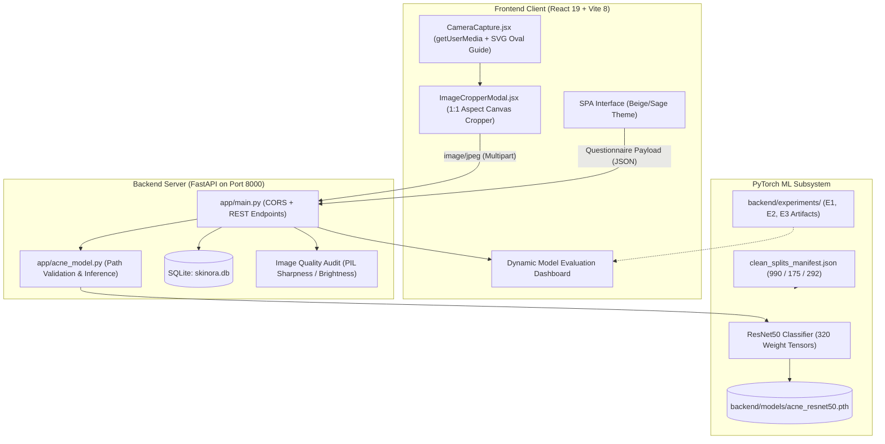

# SKINORA — Comprehensive Project State & Developer Handoff

> **Preservation Timestamp**: November 3, 2026 — 13:30 IST  
> **Repository Root**: `Skinora/` (Git branch: `main`, upstream: `https://github.com/PrathamBade/SKINORA.git`)  
> **Status**: Emergency Offline State Preserved — All Models, Code, Tests, and ML Experiments Intact.

---

## 1. Executive Summary

**SKINORA** is an end-to-end full-stack artificial intelligence web application engineered for clinical skin wellness check-ins, rule-based cosmetic routine formulation, and deep learning-based facial acne severity grading.

The deep learning subsystem is built upon a fine-tuned **ResNet50** convolutional neural network trained on the academic **ACNE04** clinical photograph dataset (1,457 images) using the 4-class **Hayashi acne severity grading criteria** (`mild`, `moderate`, `severe`, and `very_severe`).

### Current Project Health & Operational Status:
- **Full-Stack Application**: Fully operational. Frontend builds cleanly via Vite in ~300ms; FastAPI backend runs smoothly on port 8000.
- **Backend Test Suite**: **34/34 tests passing** with 0 failures across all 7 test suites (model architecture, evaluation metrics, REST API, dataset integrity, camera/crop compatibility, ACNE-ECKH pipeline, ACNE04 inspection).
- **ML Experimentation**: 3 controlled fine-tuning runs (**E1, E2, E3**) completed on the clean, leakage-free ACNE04 split. All checkpoints, configs, confusion matrices, and training histories are archived on disk.
- **Production Checkpoint**: [`backend/models/acne_resnet50.pth`](backend/models/acne_resnet50.pth) is preserved untouched with verified SHA256 `982ea2...0ce4`.
- **Offline Readiness**: All Hugging Face datasets and ImageNet weights are cached locally. The project can be run, tested, and evaluated completely offline.

---

## 2. System Architecture



### Component Details
1. **Frontend (`frontend/src/`)**:
   - Built with React 19, React Router 7, Vite 8, and vanilla CSS (`App.css`, `index.css`).
   - Sizing and typography adhere to strict contrast standards ($\ge 7.8:1$ on cream `#fffefa`) using `Playfair Display` and `DM Sans`.
   - In-browser camera capture via `CameraCapture.jsx` with automatic hardware track cleanup on unmount/cancel.
   - Interactive square image cropping via `ImageCropperModal.jsx` using HTML5 Canvas with drag/pan handles, zoom slider (0.7× to 1.5×), and optional `window.FaceDetector` API framing.
2. **Backend (`backend/app/`)**:
   - **FastAPI**: REST endpoints for assessment, model status, evaluation reporting, and static confusion matrix/loss curve serving.
   - **SQLite (`backend/skinora.db`)**: Persists user assessments with JSON-serialized acne predictions and questionnaire responses.
   - **Quality Assurance**: Checks image resolution, lighting saturation, and Laplacian variance proxies before inference.
   - **Security**: Strict regex validation (`^[a-zA-Z0-9_\-]+$`) on experiment IDs prevents directory traversal.

### REST API Surface
| Endpoint | Method | Purpose | Input / Payload |
|---|:---:|---|---|
| `/` | `GET` | Platform status & version | None |
| `/api/health` | `GET` | Service & database health probe | None |
| `/api/model-status` | `GET` | Active model readiness & metadata | None |
| `/api/model-evaluation` | `GET` | Latest verified evaluation report | Optional query `experiment_id` |
| `/api/analyze` | `POST` | Full assessment & acne inference | Form data + optional `photo` multipart |
| `/api/assessments` | `GET` | List historical assessments | None |
| `/api/assessments/{id}` | `GET` | Retrieve single assessment detail | Path parameter `id` |
| `/api/experiments/{id}/{filename}` | `GET` | Serve confusion matrix/curve plots | Validated path parameters |

---

## 3. Feature Completion Matrix

| Feature Module | Implementation Status | Verification Status | Notes |
|---|:---:|:---:|---|
| **Skin Questionnaire & Routine Engine** | Implemented | **Verified** | Custom AM/PM formulations based on skin type & sensitivity. |
| **ResNet50 Production Inference** | Implemented | **Verified** | Real-time classification into mild, moderate, severe, very severe. |
| **Dynamic AI Evaluation Dashboard** | Implemented | **Verified** | Fetches verified metrics dynamically from `/api/model-evaluation`. |
| **Assessment History Persistence** | Implemented | **Verified** | SQLite database records predictions and questionnaire responses. |
| **In-Browser Camera Capture** | Implemented | **Verified** | Media track cleanup, front/rear toggle, and permission fallbacks. |
| **Interactive 1:1 Canvas Cropper** | Implemented | **Verified** | Exports $\ge 224\text{px}$ square JPEG compatible with PyTorch transforms. |
| **ACNE04 Clean Manifest Splitting** | Implemented | **Verified** | 990 train, 175 val, 292 test; zero hash leakage across partitions. |
| **ACNE04 Bounding-Box & Fold Audit** | Implemented | **Verified** | 18,983 boxes verified; official 5-fold cross-split leakage exposed. |
| **ACNE-ECKH Pipeline Gatekeeper** | Implemented | **Verified** | Offline audit tool; awaiting institutional IRB protocol approval. |
| **Fine-Tuning E1 (Deep Layer3+4)** | Implemented | **Verified** | 10 epochs completed; val macro F1 = 74.54%, loss = 0.6164. |
| **Fine-Tuning E2 (Class-Weighted)** | Implemented | **Verified** | 10 epochs completed; val macro F1 = 70.26% (degraded Moderate). |
| **Fine-Tuning E3 (Dermatology Aug)** | Implemented | **Verified** | 10 epochs completed; val macro F1 = 74.46%, ECE = 0.0633 (best). |
| **Fine-Tuning E4 (Focal Loss)** | Spec Ready | *Not Started* | Planned next experiment; addresses boundary confusion. |
| **ROCm GPU Acceleration in WSL2** | Configured | *Partially Verified* | Dry-run package plan resolved; awaits internet for SDK install. |

---

## 4. Machine Learning Pipeline & Fine-Tuning State

### 4.1 Model Definition
- **Base Architecture**: `torchvision.models.resnet50` (pretrained ImageNet-1K).
- **Input Size**: $224 \times 224 \times 3$, normalized with ImageNet mean `[0.485, 0.456, 0.406]` and std `[0.229, 0.224, 0.225]`.
- **Classification Head**: `nn.Dropout(p=0.2)` followed by `nn.Linear(2048, 4)`.
- **Class Labels**:
  - `0`: Mild ($\le 5$ inflammatory lesions)
  - `1`: Moderate (6–20 inflammatory lesions)
  - `2`: Severe (21–50 inflammatory lesions)
  - `3`: Very Severe ($> 50$ inflammatory lesions)

### 4.2 Dataset Integrity & Clean Manifest
- **Source**: `Layered-Labs/ACNE04` on Hugging Face (1,457 clinical facial photographs).
- **Duplicate Audit Findings**: The raw ACNE04 dataset contains **38 exact duplicate groups (76 images)**, with 12 duplicate groups crossing between train and test splits in the original benchmark, and 8 duplicate pairs carrying conflicting clinical labels.
- **Clean Partition Manifest**: [`backend/models/clean_splits_manifest.json`](backend/models/clean_splits_manifest.json):
  - **Train**: 990 images (`[348 mild, 430 moderate, 124 severe, 88 very_severe]`)
  - **Validation**: 175 images (`[62 mild, 76 moderate, 22 severe, 15 very_severe]`)
  - **Test (Held-Out)**: 292 images (`[103 mild, 127 moderate, 36 severe, 26 very_severe]`)
  - **Zero Leakage**: Exactly 0 SHA256 overlap between partitions; all 8 conflicting groups quarantined inside Train.

### 4.3 Experiment History & Validation Comparison

All experiments used random seed `42` and were evaluated **strictly on the 175-image clean validation split**:

| Metric | Clean Baseline *(Production Checkpoint)* | E1 (`exp1_deep_finetune`) *(Unweighted, Deep 3+4)* | E2 (`exp2_class_weighted`) *(Inverse-Frequency Weighted)* | E3 (`exp3_dermatology_aug`) *(Conservative Derm Aug)* |
|---|:---:|:---:|:---:|:---:|
| **Loss Function** | Cross-Entropy | Cross-Entropy (Unweighted) | Weighted CE ($w=[0.71, 0.58, 2.00, 2.81]$) | Cross-Entropy (Unweighted) |
| **Augmentation** | CenterCrop Only | Baseline Aug (Scale 0.85-1.0) | Baseline Aug | Rotation $\pm 12^\circ$, ColorJitter (B:0.08, C:0.08) |
| **Finetune Depth** | Frozen / Layer4 | `deep_layer3_4` | `deep_layer3_4` | `deep_layer3_4` |
| **Epochs Run** | 8 | 10 | 10 | 10 |
| **Best Epoch** | — | 10 | 9 | 10 |
| **Validation Accuracy** | **79.43%** | 74.29% | 72.00% | 74.29% |
| **Balanced Accuracy** | **81.89%** | 75.18% | 74.46% | 75.40% |
| **Validation Macro F1** | **79.47%** | **74.54%** | 70.26% | 74.46% |
| **Validation Macro Precision** | **77.98%** | 76.22% | 68.72% | 74.66% |
| **Validation Macro Recall** | **81.89%** | 75.18% | 74.46% | 75.40% |
| **Validation Loss** | 0.8603 | **0.6164** | 0.7411 | 0.6202 |
| **Calibration Error (ECE)** | 0.0704 | 0.0925 | 0.1042 | **0.0633** *(Best calibration)* |
| **Severe (2) Recall** | **77.27% (17/22)** | 59.09% (13/22) | 59.09% (13/22) | 59.09% (13/22) |
| **Severe (2) Precision** | 80.95% | **86.67%** | 65.00% | 76.47% |
| **Very Severe (3) Recall** | **93.33% (14/15)** | **93.33% (14/15)** | **93.33% (14/15)** | **93.33% (14/15)** |

### 4.4 Checkpoint Resumability Analysis
- **Model Weight Preservation**: Complete. All 4 checkpoints on disk contain the full 320 weight and bias tensors for ResNet50.
- **Resumability Limitation**: The current checkpoints are **inference and transfer-learning checkpoints**. They do **not** contain AdamW optimizer momentum/variance states, PyTorch learning rate scheduler states, or RNG generator states. Mid-epoch training resumption is not supported; training runs must start from epoch 1 with the specified seed.

---

## 5. Checkpoint Inventory & SHA-256 Hashes

| Artifact Path | File Size | Last Modified | SHA-256 Hash | Resumable? | Purpose |
|---|:---:|:---:|---|:---:|---|
| [`backend/models/acne_resnet50.pth`](backend/models/acne_resnet50.pth) | 94,375,139 B (90.00 MB) | 2026-11-01 13:51 | `982ea27736e0a276ad532f90d8603807066aedf0a5d80c70624a6e5671f00ce4` | No (Inference) | Active Production Checkpoint |
| [`backend/experiments/exp1_deep_finetune/exp1_deep_finetune_best.pth`](backend/experiments/exp1_deep_finetune/exp1_deep_finetune_best.pth) | 94,378,655 B (90.01 MB) | 2026-11-02 21:34 | `b2499e23aed88475b98dad3a10ab702322006670289d26b3878c63f2694262db` | No (Inference) | E1 Best Checkpoint (Epoch 10) |
| [`backend/experiments/exp2_class_weighted/exp2_class_weighted_best.pth`](backend/experiments/exp2_class_weighted/exp2_class_weighted_best.pth) | 94,378,981 B (90.01 MB) | 2026-11-02 21:57 | `7239b1858dd0866ae81dcd24ddbd6755bf3e8c0cb31e06ed4a5194bd2da6d521` | No (Inference) | E2 Best Checkpoint (Epoch 9) |
| [`backend/experiments/exp3_dermatology_aug/exp3_dermatology_aug_best.pth`](backend/experiments/exp3_dermatology_aug/exp3_dermatology_aug_best.pth) | 94,379,307 B (90.01 MB) | 2026-11-02 22:23 | `c93de921086002fae3f606c4376f75b05b89d597ca69947270dd8417d4414546` | No (Inference) | E3 Best Checkpoint (Epoch 10) |

---

## 6. Environment & Hardware Setup

### 6.1 Verified Local Host Environment (Windows 11)
- **OS**: Windows 11 Build 26200
- **Python**: 3.10.0 (AMD64)
- **Virtual Environment**: `Skinora\venv`
- **PyTorch**: `2.14.1+cpu`
- **Torchvision**: `0.29.2+cpu`
- **Node.js**: `v24.19.0`
- **npm**: `11.10.1`
- **Git**: `2.50.1.windows.1`
- **Git LFS**: `3.5.1`

### 6.2 AMD ROCm / WSL2 Setup Status
- **Host GPU Hardware**: AMD Radeon RX 7900 XT (Architecture: `gfx1100`, RDNA 3).
- **Target Distribution**: Ubuntu 24.04.5 LTS on WSL2.
- **Verified Status**:
  - `ROCDXG` runtime package previously installed.
  - ROCm CLI toolchain previously installed.
  - Last completed command: `rocm install sdk --family gfx110X-all --dry-run` successfully resolved a package plan containing ROCm 7.14.1 and PyTorch 2.11.0.
- **Unverified Status**:
  - The SDK installation was a **dry run** only. Full installation was not completed due to network outage.
  - PyTorch GPU execution on `gfx1100` remains **unverified**; all experiments were run on CPU in Windows.
- **Action Required Once Connectivity Returns**:
  1. Open WSL2 terminal: `wsl -d Ubuntu-24.04`
  2. Execute actual SDK installation: `sudo rocm install sdk --family gfx110X-all`
  3. Export RDNA 3 compatibility environment variable: `export HSA_OVERRIDE_GFX_VERSION=11.0.0`
  4. Test PyTorch ROCm GPU access:
     ```bash
     python3 -c "import torch; print('CUDA/ROCm Available:', torch.cuda.is_available(), 'Device:', torch.cuda.get_device_name(0))"
     ```

---

## 7. Developer Handoff Checklist & Commands

### 7.1 Immediate Developer Setup
```powershell
# 1. Navigate to repository
cd Skinora

# 2. Verify backend test suite (34 tests)
$env:MPLCONFIGDIR = "$env:TEMP"
.\venv\Scripts\python.exe tests/run_tests.py

# 3. Start FastAPI backend (port 8000)
cd backend
..\venv\Scripts\python.exe -m uvicorn app.main:app --host 127.0.0.1 --port 8000

# 4. Start Vite frontend dev server (port 5173, in separate terminal)
cd Skinora\frontend
npx vite --host 127.0.0.1 --port 5173
```

### 7.2 Running Single Model Inference Check
```powershell
cd Skinora\backend
$env:MPLCONFIGDIR = "$env:TEMP"
..\venv\Scripts\python.exe -c "
import acne_model
from PIL import Image
import io

img = Image.new('RGB', (256, 256), color=(220, 190, 170))
buf = io.BytesIO()
img.save(buf, format='JPEG')
pred = acne_model.predict_acne(buf.getvalue())
print('Inference Status:', pred['status'])
print('Predicted Class:', pred['class'])
print('Class Probabilities:', pred['class_probabilities'])
"
```

### 7.3 Reproducing Clean Model Evaluation
```powershell
cd Skinora\backend
$env:HF_DATASETS_OFFLINE = "1"
$env:MPLCONFIGDIR = "$env:TEMP"

# Evaluate production model on clean validation split
..\venv\Scripts\python.exe training/evaluate_acne_model.py `
    --checkpoint "models/acne_resnet50.pth" `
    --split "val" `
    --protocol "clean" `
    --split-manifest "models/clean_splits_manifest.json"
```

### 7.4 Executing the Next Planned Experiment: E4 (Focal Loss)
To address the persistent Class 2 (Severe) recall deficit without the threshold distortion caused by class weighting, execute Focal Loss ($\gamma = 2.0$):
```powershell
cd Skinora\backend
$env:HF_DATASETS_OFFLINE = "1"
$env:MPLCONFIGDIR = "$env:TEMP"

..\venv\Scripts\python.exe training/train_acne_model.py `
    --experiment-id "exp4_focal_loss" `
    --architecture "resnet50" `
    --finetune-mode "deep_layer3_4" `
    --epochs 10 `
    --batch-size 16 `
    --backbone-lr 0.00002 `
    --head-lr 0.0002 `
    --weight-decay 0.0001 `
    --dropout 0.2 `
    --no-class-weights `
    --scheduler "plateau" `
    --seed 42 `
    --split-manifest "models/clean_splits_manifest.json"
```

---

## 8. Git Preservation & Upstream Push Instructions

### 8.1 Checkpoint Handling Policy
- Standard GitHub repositories reject individual files exceeding **100 MB**.
- The four `.pth` files are each **~94.4 MB**. While technically below the 100 MB hard limit, pushing 377 MB of binaries directly into standard Git history causes repository bloat.
- **Git Policy**: `.gitignore` safely excludes `*.pth` checkpoints. Checkpoints remain preserved locally on disk.
- All experiment configurations, training histories, confusion matrices, evaluation metrics, and split manifests are fully tracked by Git.

### 8.2 What to Run When Internet Connectivity Returns
When network access is restored, push the preserved local commits to GitHub:
```powershell
cd Skinora

# 1. Verify remote configuration
git remote -v
# Output should show: origin https://github.com/PrathamBade/SKINORA.git

# 2. Check current status
git status

# 3. Push local main branch to upstream GitHub
git push origin main
```
