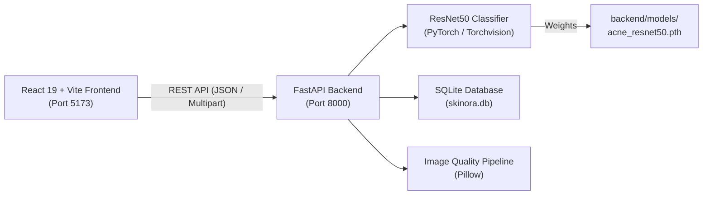

# SKINORA — AI-Powered Skin Health Assessment & Skincare Recommendation System

[](https://fastapi.tiangolo.com)
[](https://pytorch.org)
[](https://react.dev)
[](https://vitejs.dev)
[](https://python.org)

**Skinora** is an end-to-end full-stack AI web application designed for facial wellness check-ins, rule-based skincare guidance, and deep learning-based acne severity classification using fine-tuned **ResNet50** on the **ACNE04** clinical dataset.

> [!IMPORTANT]
> **Developer & Reviewer Handoff**: See [**`PROJECT_STATE.md`**](PROJECT_STATE.md) for the comprehensive current project state, active fine-tuning experiments (E1, E2, E3), clean split verification, AMD ROCm/WSL2 setup status, and developer handoff instructions.

---

## 🌟 Key Features

1. **ResNet50 Acne Severity Classifier**:
   - Transfer learning using ImageNet-1K pretrained weights fine-tuned on 1,457 facial acne photographs.
   - 4-class ordinal grading: `mild`, `moderate`, `severe`, and `very_severe`.
   - Test accuracy: **61.30%**, Balanced accuracy: **61.20%**, Macro F1: **58.98%**.
2. **Interactive AI Model Evaluation Dashboard**:
   - Dedicated dashboard displaying real-time verified model benchmarks.
   - Interactive numerical and heatmap confusion matrix, per-class breakdown tables, and calibration ECE analysis.
3. **Questionnaire & Personalized Routine Engine**:
   - AM/PM routine suggestions tailored to user-reported skin type, sensitivity, and wellness concerns.
4. **Photo Quality Assessment**:
   - Real-time in-memory checks for image resolution, brightness distribution, and sharpness proxies.
5. **Dermatologist Search & Holistic Care Approaches**:
   - Location-based clinician search and comparative educational overviews of conventional, Ayurvedic, and alternative skincare traditions.

---

## 🏗️ System Architecture



---

## 🚀 Quick Start Guide

### 1. Prerequisites
- Python 3.10+
- Node.js 18+ and npm

### 2. Backend Setup
```powershell
cd Skinora\backend
# Create & activate virtual environment
python -m venv ..\venv
..\venv\Scripts\python.exe -m pip install -r requirements.txt

# Start FastAPI Server
..\venv\Scripts\python.exe -m uvicorn app.main:app --host 127.0.0.1 --port 8000 --reload
```
API Documentation will be accessible at: [http://127.0.0.1:8000/docs](http://127.0.0.1:8000/docs)

### 3. Frontend Setup
```powershell
cd Skinora\frontend
npm install
npm run dev
```
Open web app in your browser: [http://localhost:5173/](http://localhost:5173/)

---

## 📊 Model Training & Evaluation

To reproduce the model training run or evaluate an existing checkpoint:

```powershell
# Train model with layer-4 fine tuning and balanced class weights
cd Skinora\backend
..\venv\Scripts\python.exe -m Skinora.backend.training.train_acne_model --experiment-id resnet50_optimized --epochs 8 --batch-size 16 --finetune-mode partial_layer4 --set-as-production

# Evaluate model on held-out test split
..\venv\Scripts\python.exe -m Skinora.backend.training.evaluate_acne_model --checkpoint models\acne_resnet50.pth --split test --output-dir experiments\baseline_resnet50
```

For complete documentation:
- 📌 [Comprehensive Project State & ML Handoff](PROJECT_STATE.md)
- 📖 [Model Training Guide](MODEL_TRAINING_GUIDE.md)
- 📊 [Model Evaluation Report](MODEL_EVALUATION.md)
- 🪪 [Model Card](MODEL_CARD.md)
- 🎓 [Viva Defense Preparation](VIVA_PREPARATION.md)

---

## 🔒 Privacy & Clinical Disclaimer
Skinora is an **educational research prototype** and not a certified medical device. Photos uploaded for assessment are processed strictly in RAM and never stored on disk or server databases. Consult a licensed dermatologist for medical skin concerns.

